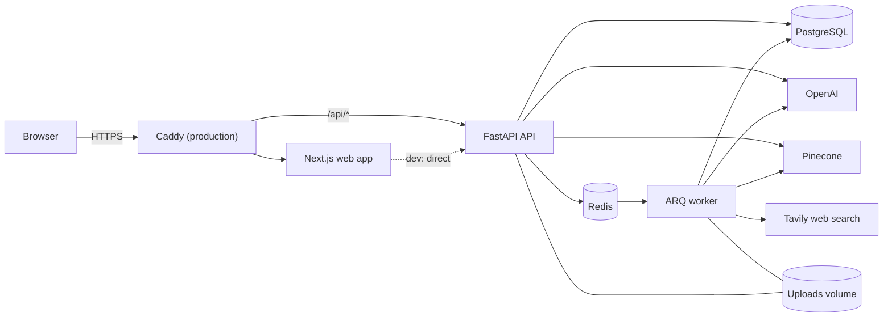

# AI Agent Workspace

A full-stack platform for working with your own documents and the web through AI: upload files, ask questions and get **cited answers**, run **multi-agent research** that produces a sourced report, and build **custom agents** with their own instructions, knowledge bases and tools.

**Next.js · TypeScript · FastAPI · PostgreSQL · Redis · OpenAI · Pinecone · LangChain (optional) · Docker**

<!-- Add screenshots to docs/screenshots/ (see the README there) and uncomment:


-->

## Features

| | |
|---|---|
| **Documents** | PDF, DOCX, TXT, CSV and Markdown upload with strict validation (extension, MIME type, file signature, size, zip-bomb check), background parsing, cleaning, page-aware chunking and indexing, live status, reindexing |
| **Retrieval** | Hybrid search: vector similarity (Pinecone) plus Postgres full-text, fused with reciprocal rank fusion, metadata-filtered per user, then re-ranked (LLM or BM25) |
| **Chat** | Streaming answers (SSE) with `[n]` citations that open the source passage, conversation memory, stop, regenerate, copy, Markdown |
| **Grounding** | If nothing relevant is found the model is never called: you get "I couldn't find this in your documents". Prompts forbid invented sources, and web or tool text is treated as untrusted |
| **Research** | A planner, document agent, web research agent, analyst, summarizer and citation agent run in the background with retries, timeouts, fallbacks and partial-failure handling; live progress; export to Markdown or PDF; a searchable source library |
| **Agent Builder** | Custom agents: instructions, response style, model, temperature, knowledge bases, tools (document search, web search, calculator, CSV analysis, summarizer), step limits |
| **Operations** | JWT auth with rotating refresh tokens, rate limiting, security headers, request ids, redacted logs, usage tracking, admin dashboard, health probes |

## Architecture



The API handles requests and streams answers. Anything slow, such as parsing and embedding documents or running a research task, goes through a Redis queue to the worker, which writes progress to Postgres. The browser replays that progress over Server-Sent Events, so closing the tab never stops a run. Details, data model and flow diagrams: [docs/architecture.md](docs/architecture.md).

Every external service sits behind a small interface and can be swapped in one place (`backend/app/rag/providers.py`): chat model (OpenAI or LangChain), embeddings, vector store (Pinecone or Postgres), re-ranker, web search, file storage.

## Quick start with Docker

Needs Docker Desktop. No API keys are required to try it: without keys the app uses offline stand-ins (mock embeddings, extractive answers, a Postgres vector store) and says so in the UI.

```powershell
copy .env.example .env
docker compose up --build
```

Open http://localhost:3000, register, create a workspace and a knowledge base, upload a document, wait for **Indexed**, then ask a question in **Chat**. API docs are at http://localhost:8000/docs.

Make yourself an admin: `docker compose exec backend python -m app.utils.make_admin you@example.com`

## Local development (Windows, VS Code, PowerShell)

Prerequisites: Node.js LTS, Python 3.11+, Docker Desktop (for Postgres and Redis).

```powershell
copy .env.example .env
docker compose up -d postgres redis

# Terminal 1: API
cd backend
python -m venv venv
venv\Scripts\activate
pip install -r requirements-dev.txt
alembic upgrade head
uvicorn app.main:app --reload

# Terminal 2: worker (required for document indexing and research)
cd backend
venv\Scripts\activate
arq app.workers.tasks.WorkerSettings

# Terminal 3: web app
cd frontend
npm install
npm run dev
```

If documents stay on **Queued**, the worker is not running.

## Using the real services

| Service | What you get | Setup |
|---|---|---|
| OpenAI | Real embeddings, answers, agent reasoning, LLM re-ranking | `OPENAI_API_KEY` from https://platform.openai.com/api-keys |
| Pinecone | Production vector search | `PINECONE_API_KEY`, `PINECONE_INDEX`, then `python -m app.utils.setup_pinecone` to create the index |
| Tavily | Web research | `TAVILY_API_KEY` from https://tavily.com |

Restart the API and worker after changing `.env`, then **Reindex** existing documents so they get real embeddings. Keys live only in the backend `.env`; nothing secret reaches the browser. Full list of settings: [.env.example](.env.example).

## Project structure

```
backend/
  app/
    api/routes/      HTTP endpoints (thin: validate, call a service, shape the response)
    services/        business logic (auth, documents, retrieval, chat, research, agents, admin, usage)
    rag/             parsing, cleaning, chunking, embeddings, vector stores, re-ranker, prompts, providers
    agents/          planner, document, web, analyst, summarizer, citation agents; orchestrator; tools/
    db/models/       SQLAlchemy models
    schemas/         Pydantic request and response models
    core/            settings, security, rate limiting, middleware, logging
    workers/         job queue producer and the ARQ worker
  alembic/versions/  database migrations
  tests/             pytest suite
frontend/
  app/               Next.js App Router pages ((app) group is the signed-in area)
  components/        UI components      lib/  API client, hooks, SSE      store/  Zustand stores
  e2e/               Playwright test
deploy/Caddyfile     HTTPS reverse proxy        docs/   architecture, deployment, quality gate
docker-compose*.yml  local and production stacks
```

## API

Interactive docs: `/docs` (Swagger) and `/redoc`. Every response is `{success, data}` or `{success: false, error: {code, message, request_id}}`.

| Area | Endpoints |
|---|---|
| Auth | `POST /api/auth/register` `login` `refresh` `logout`, `GET /api/auth/me` |
| Workspaces | `GET/POST /api/workspaces`, `GET/PATCH/DELETE /api/workspaces/{id}` |
| Knowledge bases | `GET/POST /api/knowledge-bases`, `GET/PATCH/DELETE /api/knowledge-bases/{id}` |
| Documents | `POST /api/documents/upload`, `GET /api/documents`, `GET/DELETE /api/documents/{id}`, `GET .../chunks`, `POST .../reindex` |
| Search | `POST /api/search` (`hybrid`, `vector` or `keyword`) |
| Chat | `POST /api/chat` (SSE), `GET /api/conversations`, `GET/PATCH/DELETE /api/conversations/{id}` |
| Research | `POST /api/research`, `GET /api/research`, `GET /api/research/{id}` `/status` `/events` (SSE) `/export?format=markdown\|pdf`, `POST .../cancel` `.../rerun`, `DELETE`, `GET /api/research/sources` |
| Agents | `GET/POST /api/agents`, `GET/PUT/DELETE /api/agents/{id}`, `GET /api/agents/options` |
| Usage and admin | `GET /api/usage/me`, `GET /api/admin/overview` `usage` `users`, `PATCH /api/admin/users/{id}` (admin only) |
| Health | `GET /api/health`, `GET /api/health/ready` |

## Testing

```powershell
cd backend;  pytest                      # needs Postgres (Redis is not needed); also: ruff check .
cd frontend; npm test                    # Vitest + Testing Library
cd frontend; npm run typecheck; npm run lint
cd frontend; npx playwright install chromium; npm run test:e2e   # needs the full stack and the worker running
```

`npm install` creates `frontend/package-lock.json`; **commit it** (CI and the Docker build use it for reproducible installs).

CI (`.github/workflows/ci.yml`) applies the migrations to an empty database, runs the backend tests and lint, the frontend typecheck, lint, tests and build, and boots the whole Docker stack and probes it. The manual checklist is in [docs/quality-gate.md](docs/quality-gate.md).

## Security

Passwords are hashed with bcrypt; access tokens are short-lived and kept in memory, refresh tokens are rotating httpOnly cookies with reuse detection. All data is scoped to its owner (other users' ids return 404). Uploads are validated by content, not just name. Rate limits, request-size limits, security headers and request ids are on by default; secrets are redacted from logs; `ENVIRONMENT=production` refuses weak secrets, insecure cookies and wildcard CORS. See [docs/architecture.md](docs/architecture.md#security-model) for the full list.

## Deployment

One server, Docker and a domain: copy `.env.production.example` to `.env`, fill it in, then

```bash
docker compose -f docker-compose.yml -f docker-compose.prod.yml up -d --build
```

Caddy obtains HTTPS certificates automatically and routes `/api` to the API and everything else to the web app. Backups, upgrades, scaling and troubleshooting: [docs/deployment.md](docs/deployment.md).

## Known limitations

- Scanned or image-only PDFs have no extractable text (no OCR); they fail with a clear message.
- The Postgres vector store used without Pinecone is for development scale only.
- PDF export uses built-in fonts and covers Latin text; Markdown export handles any script.
- There is no URL-fetching tool (it would expose the server to requests aimed at internal addresses).
- No email verification, password reset or two-factor authentication yet; registration confirms whether an email is taken.
- Uploads live on a local volume; S3 or similar needs a new storage adapter (`app/services/storage_service.py` is the single place).

## Roadmap

OCR for scanned documents, password reset and email verification, OAuth sign-in, workspace sharing and roles, S3 storage, streaming research reports, evaluation harness for retrieval quality, per-user usage quotas, an in-app command palette.

## License

MIT, see [LICENSE](LICENSE).
