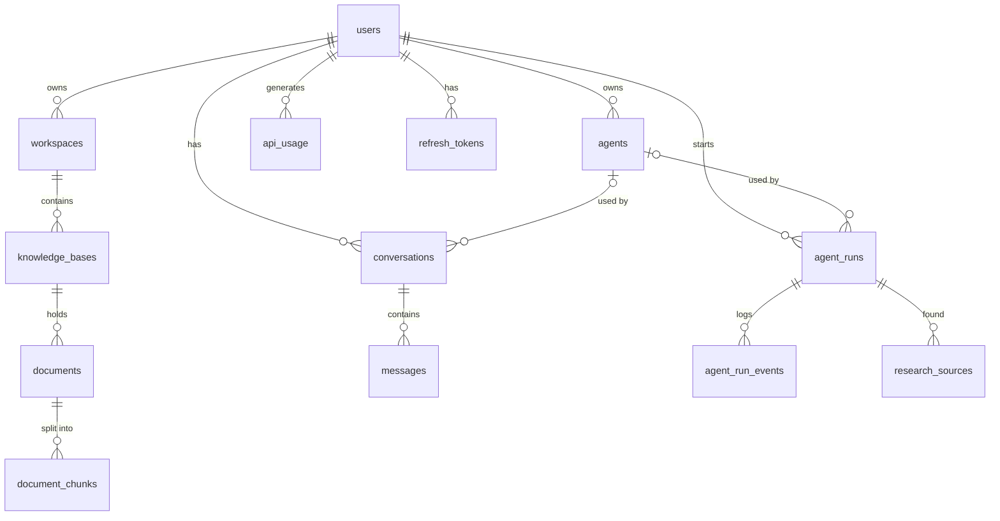
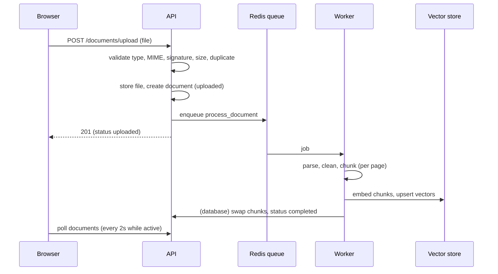
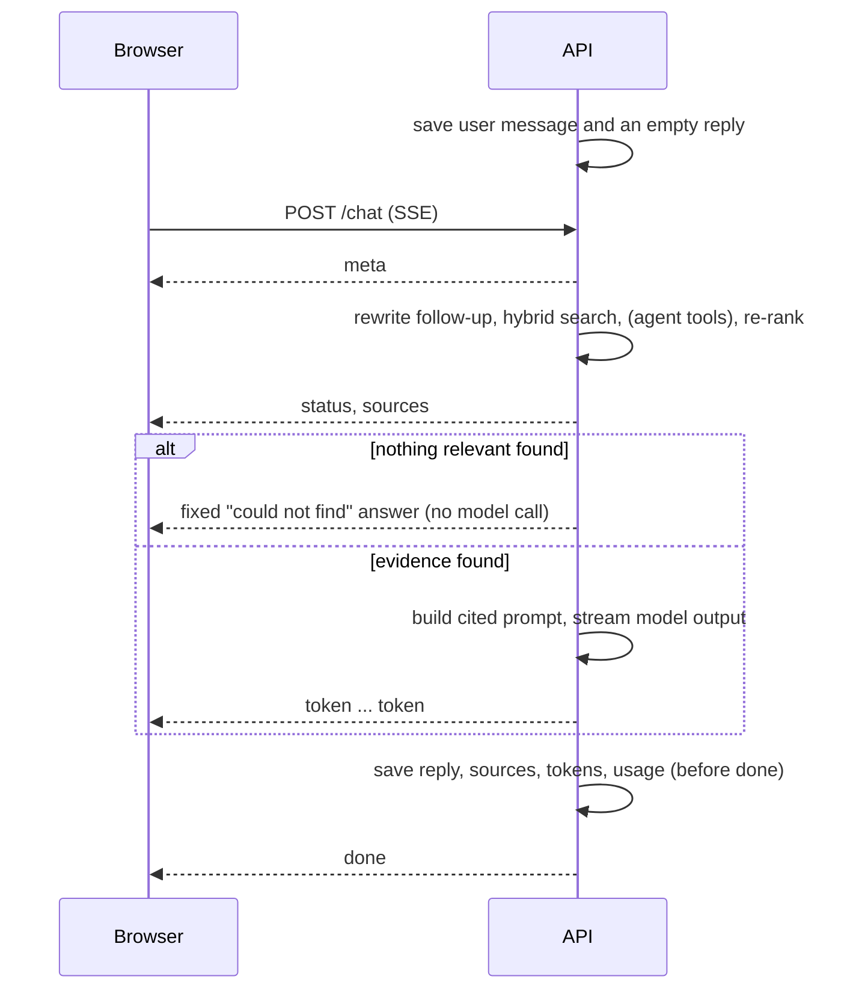
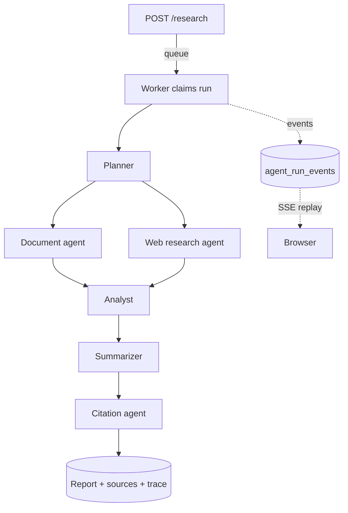

# Architecture

## Components

| Component | Role |
|---|---|
| Next.js (App Router, TypeScript, Tailwind, TanStack Query, Zustand) | UI. The access token lives in memory; the refresh token is an httpOnly cookie |
| FastAPI (async SQLAlchemy, Pydantic) | REST API and Server-Sent Events. Stateless apart from the database |
| PostgreSQL | All application data, chunks, full-text index, event log, usage records |
| Redis | Job queue (ARQ) and shared rate-limit counters |
| ARQ worker | Document processing and research runs, with heartbeats and cancellation |
| OpenAI | Embeddings, answers, agent reasoning (through the OpenAI SDK, or LangChain when `CHAT_PROVIDER=langchain`) |
| Pinecone | Vector index, one namespace per knowledge base |
| Tavily | Web search for the research agents |

## Data model

`local_vectors` (development vector store) and `activity_logs` (dashboard feed) are standalone. Vectors carry user, knowledge base, document, page and chunk metadata; the chunk text itself stays in Postgres, and every search hit is re-checked there for ownership.

## Document ingestion

Embedding happens before the old chunks are replaced, so a failed reindex leaves the previous version intact.

## Chat

If the client disconnects, the reply is saved as `stopped` with what was written (finalisation runs as a shielded task).

## Research

Retrieval steps run in parallel. Each step has a timeout and retries transient errors. If the planner, analyst or summarizer fail they fall back to a simpler method with a warning; one failed retrieval step does not stop the run; no evidence produces an honest "won't guess" report. Cancellation and heartbeats are checked by a watcher task, and a run whose worker disappears is marked failed instead of hanging.

## Security model

- **Identity:** bcrypt passwords; 30-minute access JWT; refresh tokens stored server-side, rotated on use, with reuse detection that revokes all sessions; deactivated users are rejected on every request.
- **Isolation:** every query filters by the owner; foreign ids return 404; an agent limited to certain knowledge bases never falls back to all of them when those are deleted.
- **Input:** Pydantic validation everywhere; uploads checked by extension, MIME type, magic bytes and decompressed size; filenames sanitised and files stored under random ids; body-size limits.
- **Abuse controls:** rate limits per IP and per user (Redis), login lockout per IP and email.
- **Output:** security headers and a strict CSP on the API; Markdown from models and web pages is rendered without raw HTML.
- **Prompt injection:** documents, web pages and tool results are quoted as data in prompts with an explicit instruction not to follow them; agent instructions sit below the fixed grounding rules.
- **Secrets:** server-side only, redacted from logs; production refuses weak configuration.

## Key decisions

| Decision | Reason |
|---|---|
| ARQ instead of Celery | Async-native and works on Windows without extra pools |
| Event log in Postgres, replayed over SSE | Runs survive closed tabs and API restarts; reconnecting is trivial |
| Provider interfaces | Each vendor can be replaced in one file; offline stand-ins make the whole app testable without keys |
| Custom orchestration rather than an agent framework | Deterministic, testable failure handling; LangChain remains available as the model client |
| Chunk text in Postgres, vectors elsewhere | One source of truth and an ownership check on every hit |
| Hybrid retrieval plus re-ranking | Vectors catch meaning, full-text catches exact terms, the re-ranker trims noise |
